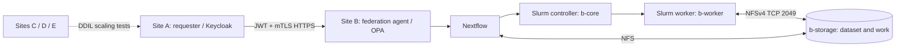

# Sovereign Communication Cloud — Federated Genomics Midterm

**Reproducibility repository (prepared staging package)** · Proxmox / Ubuntu / Rust / Keycloak / mTLS / OPA / Nextflow / Slurm / NFS / DDIL

This project investigates a **move-to-data sovereign genomics federation**: Site A can authenticate and submit a genomics workflow to Site B; authorization happens at the federation API; Site B's Nextflow–Slurm pipeline performs work against storage within its private network. E1–E5 test DDIL network behavior, multi-site scale, security denial semantics and data-local execution.

> **Publication status:** This repository package contains available research artifacts and a safe on-lab collection tool. It is NOT a complete snapshot of `/root/genomics-final-experiment/`. Additional results, complete Cargo sources and policies must be collected from the real lab host before claiming full reproducibility. Publishing real genomic data, private keys or PCAP payloads is intentionally prohibited by the supplied collection defaults.

## Architecture



Site B private addressing observed during the experiment: b-core `10.20.20.10`, b-storage `10.20.20.20`, b-worker `10.20.20.30`; Site A private endpoint `10.10.10.10`. Values are lab examples, not universally valid deployment settings.

## Repository layout

| Path | Contents |
| --- | --- |
| `scripts/provisioning/` | Proxmox and Ceph/NFS provisioning variants (review before use) |
| `scripts/experiments/` | E1–E4 and multi-site DDIL experiment runner variants |
| `scripts/audit/` | E5 synchronized cached/fresh egress audit |
| `src/federation-agent/` | Historical Rust agent source candidate (requires verification and Cargo files) |
| `architecture/` | Editable diagrams and slide decks |
| `docs/guides/`, `docs/research/`, `docs/presentations/` | Engineering/research documentation |
| `results/` | Public-safe summaries, grouped by experiment |
| `evidence/` | Manifests; restricted raw artifacts kept off Git |
| `tools/` | Safe lab collection and publication review scripts |

## Research experiments

| Experiment | Question | Evidence |
| --- | --- | --- |
| E1 | Does applied impairment match target latency/loss/rate? | `e1-network-verification-*.csv` |
| E2/E3 | How do request outcomes and timing vary with 3/4/5 sites and DDIL severity? | `e2-e3-*sites-*.csv`, summaries |
| E4 | Are JWT, mTLS, OPA and fail-closed controls enforced? | `e4-security-battery-*.csv` |
| E5 | Can computation run at Site B without exporting the dataset over the tested federation API? | Slurm traces, API results, six-interface traffic summaries |

## Observed E5 milestone (2026-10-10)

- Fresh federation job `ae1dc722-064b-46bf-bbb2-d62314948cf2`: **COMPLETED**, exit code 0, about 124 seconds end-to-end.
- Four new Slurm task IDs **19–22** for BWA_INDEX, FASTQC, ALIGN and VARIANT_CALL; all completed without cache reuse.
- Captures on three Site B VMs, two interfaces each; six PCAP checksums verified locally.
- Fresh worker ↔ storage conversation: ~**1.09 MB** of bidirectional frame bytes on the private NFS path, compared with **402 bytes** in the earlier cached run.
- Site A ↔ Site B conversation: approximately **12 KB** of bidirectional frame bytes during fresh execution.
- The raw-export policy endpoint returned HTTP **403** in targeted security tests.

**Interpretation:** Local execution and restricted tested raw export are supported. This does **not** prove that all genomic information stays local under all circumstances; metadata captures omit payload inspection and management egress existed.

## Quick start

```bash
# On the authorized lab controller (a-core):
# First review scripts, configuration, credentials and infrastructure assumptions.
./tools/collect-lab-artifacts.sh /path/to/cloned/repository
./tools/prepublish-check.sh /path/to/cloned/repository
# Review the generated inventory and diffs before committing.
git status --short
```

See [reproducibility procedure](docs/reproducibility.md), [result provenance](results/README.md), and [evidence policy](evidence/README.md).

## Security and publishing

Do not commit `site.env`, user credentials, JWTs, CA private keys, Munge keys, SSH keys, `.pcap` files, unsanitized packet metadata, identifiable genomic FASTQ/BAM/VCF, or sensitive server logs. `.gitignore` is a backstop, not a substitute for inspection. Avoid force-pushing or rewriting the existing upstream repository history. Repository license is not inferred; add one only if you hold the rights to publish the included work.

## Attribution and research limitations

Historical scripts and decks are successive iterations and may have environment-specific values, obsolete flags, or unresolved assumptions. Validate each script before execution. Existing published code or figures from third parties retain their original licensing terms. Performance numbers from a small demonstration dataset should not be generalized to production workloads.
